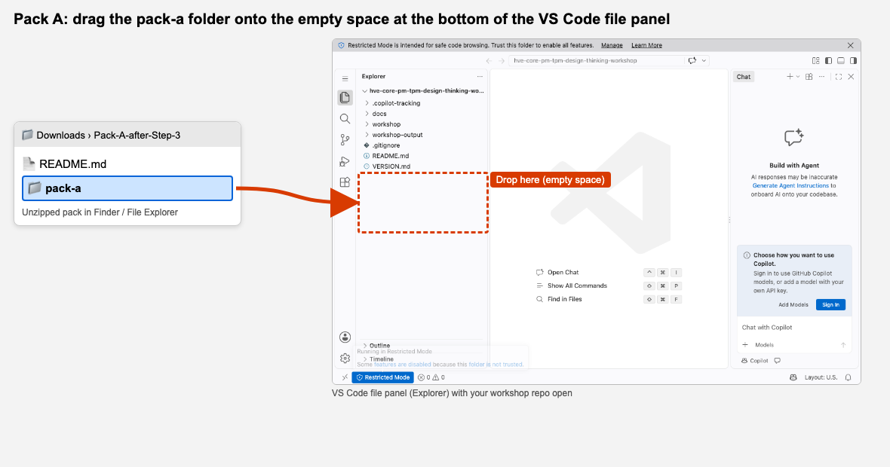
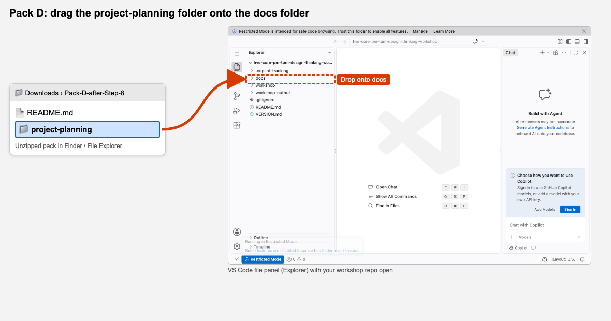

<a id="top"></a>

# Workshop guide (v6.3)

From a vague product idea to a planned backlog, with AI agents helping and you deciding.

> All data in this workshop is made up. Never type real financial data, yours or anyone's.

**Contents**

- [Start here](#start-here)
- [Step 0 · Look at three broker apps](#step-0)
- [Step 1 · First conversation with DT Coach](#step-1)
- [Load Pack A](#load-pack-a)
- [Step 4 · Brainstorm](#step-4)
- [Step 6 · Test a prototype by hand](#step-6)
- [Load Pack D and guided read](#load-pack-d)
- [Step 9 · Turn requirements into a plan](#step-9)
- [Step 10 · Look back: how sure are we?](#step-10)
- [Background (optional reading)](#background)
- [Words you'll hear](#words)


<a id="start-here"></a>

## Start here

- **This guide is the only document you need.** The slide on the projector tells you which section you're on.
- **You work in pairs.** The **driver** types and clicks; the **assistant** reads this guide aloud and checks each step. Swap at every break.
- **What today is about:** a way of working. Understand the problem first, then explore ideas, test them, and only then write down what to build. AI assistants help at each stage; you make the decisions. Where a stage would take too long, everyone loads a ready-made **pack** of files to continue from.
- **Your role:** the **Product Owner**, the person who decides what a product does, for whom and why. You speak for a made-up investor (see [Background](#background)).
- **Questions to the room** ("Regroups") are answered aloud. Anything else you want to raise: note it and bring it to the 15:45 Q&A.
- **Workshop files** are in the workshop repository: [costastselios/hve-core-pm-tpm-design-thinking-workshop](https://github.com/costastselios/hve-core-pm-tpm-design-thinking-workshop). Paths in this guide (like `workshop/00-start/problem-domain.md`) are relative to that repository, as you see it in VS Code.

### How to talk to an AI agent in VS Code

1. Open the workshop folder in **VS Code**. The file panel (Explorer) is on the left.
2. Open **Copilot Chat**: the chat icon at the top of VS Code (or **Ctrl+Alt+I**; **Cmd+Ctrl+I** on Mac).
3. Start a **new chat** with the **+** at the top of the chat panel whenever this guide says so.
4. Pick the agent in the **agent picker**, the dropdown below the chat box: **DT Coach** or **PRD Builder**.
5. **Attach a file:** drag it from the file panel into the chat box. It appears as a chip above your message.
6. **Prompts:** every prompt below is in a grey box. Use the **copy button** in its top-right corner, then paste into the chat.

### The day

| Time | Section | Who |
|---|---|---|
| 10:40 | [Step 0 · Look at three broker apps](#step-0) | Pairs |
| 11:10 | [Step 1 · First conversation with DT Coach](#step-1) | Pairs |
| 11:50 | What two investors told us | Facilitator |
| 12:00 | [Load Pack A](#load-pack-a) | Pairs |
| 12:10 | [Step 4 · Brainstorm](#step-4) | Pairs |
| 13:30 | The shared product idea | Facilitator |
| 13:40 | [Step 6 · Test a prototype by hand](#step-6) | Pairs |
| 14:40 | [Load Pack D and guided read](#load-pack-d) | Pairs + facilitator |
| 15:05 | [Step 9 · Turn requirements into a plan](#step-9) | Pairs |
| 15:25 | [Step 10 · Look back](#step-10) | Everyone |
| 15:45–16:00 | Close and Q&A | Everyone |


[↑ Back to top](#top)

<a id="step-0"></a>

## Step 0 · Look at three broker apps

*10:40 · 20 minutes · no AI*

### Do this

1. In the file panel, open `workshop/00-start/problem-domain.md` ([`workshop/00-start/problem-domain.md`](https://github.com/costastselios/hve-core-pm-tpm-design-thinking-workshop/blob/main/workshop/00-start/problem-domain.md)). Right-click it › **Open Preview** so the pictures show.
2. Read the short primer, then look at **Broker 1**, **Broker 2** and **Broker 3** in that order.
3. For each broker, talk with your partner: **what does this app know** about the investor's money, and **what can't it know**?

✅ **You're done when** you can say in one sentence why none of the three apps answers "How do I keep track of everything I own in one place?" The facilitator will ask the room at 11:00.

**What you're looking at:** a **broker** is a company (and app) you buy and hold investments through. The investor uses three of them. Each app is accurate about its own slice and blind to the other two.

**Things to notice:** currencies (US dollars, euros, UAE dirhams, sometimes mixed in one list); how old the prices are (Broker 2 says "15 min delay"); whether an app shows what you paid, or only today's value. Don't design a solution yet.


[↑ Back to top](#top)

<a id="step-1"></a>

## Step 1 · First conversation with DT Coach

*11:10–11:40 · 30 minutes*

### Do this

1. Open a **new chat** and pick **DT Coach**.
2. Drag `workshop/00-start/ambiguous-product-idea.md` ([`workshop/00-start/ambiguous-product-idea.md`](https://github.com/costastselios/hve-core-pm-tpm-design-thinking-workshop/blob/main/workshop/00-start/ambiguous-product-idea.md)) from the file panel into the chat box.
3. **11:10:** paste:

```text
Use HVE Core Design Thinking to develop this early idea. Treat it as hypotheses, not validated requirements. Start at the appropriate Design Thinking method. Do not jump to BRD, PRD, backlog or implementation.
```

4. A long warning box appears first. That's normal. Then answer each question in **one or two sentences**, as the Product Owner, with a tag (see below).
5. **11:30:** paste:

```text
We have 10 minutes left. Summarise what we've established so far, list what's still open as open questions, and stop here. Do not start the next method.
```

6. **11:40: stop**, even if the coach wants more.

✅ **You'll see:** the first reply takes about 2 minutes; then one question at a time. After the 11:30 prompt, a short summary of what's established and what's still open, and the coach stops. Nothing needs saving or handing in.

> **Why this step, if nothing is kept?** Your Step 1 answers are **not carried forward**. At 12:00 everyone continues from the same saved run (Pack A), so all pairs work from the same starting point. The point of Step 1 is to see **how the coach questions a vague idea** before anyone designs anything.

**Tag every answer**

| Tag | Use it when… |
|---|---|
| Decision | You're choosing, as Product Owner. |
| Assumption | It's a best guess that nobody has checked. |
| Open question | You don't know yet. That's a good answer. |

**Example answers**

| If the coach asks… | You could say |
|---|---|
| Are you the investor? | No. I'm the Product Owner, speaking for an investor who makes their own choices, uses three broker apps, and wants one total in dirhams. (Decision) |
| What's hard for them today? | They log into three apps and keep a spreadsheet with hand-typed prices and exchange rates that go out of date, so they stop trusting the total. (Assumption) |
| What does "factual history" mean? | What they actually owned and what it was worth on past dates. No predictions, no advice, no tax. (Decision) |
| What would success look like? | They can see everything in dirhams, with where and when each value came from, and trust it without retyping. (Decision) |

**If the coach asks something unexpected:** Don't know? Say **"Open question"**. Asked for real numbers? "Use a placeholder; the investor is made up." Suggests features or documents? "Let's stay on the problem for now." Says you must talk to real investors? "Agreed; we'll get notes from real investors next. Please carry on." Long reply? "Summarise in three bullets and ask me your next question."


[↑ Back to top](#top)

<a id="load-pack-a"></a>

## Load Pack A

*12:00 · about 10 minutes · after the facilitator's 11:50 talk*

A **pack** is a set of ready-made files from the stages you skip. Loading it puts everyone at the same starting point.

### Do this

**Download:** [Pack-A-after-Step-3.zip](https://github.com/costastselios/hve-core-workshop-reference/raw/main/Pack-A-after-Step-3.zip) (also posted in the workshop Teams channel)

**Unzip it:**
- **Mac:** double-click the zip.
- **Windows:** right-click → **Extract All…** → **Extract**.

**Golden rule:** if VS Code ever asks **"Replace?"**, click **Cancel**.

1. Drag the **`pack-a`** folder from the unzipped pack onto the **empty space at the bottom of the VS Code file panel**, so it lands at the top level next to `docs` and `workshop`.

   

2. **Check:** the VS Code file panel now shows a top-level folder **`pack-a`**. Open it to see `pack-a › dt › portfolio-tracker › coaching-state.md`. Your own Step 1 files in `.copilot-tracking` are untouched.

3. Open a **new** Copilot Chat and pick **DT Coach**. Don't continue your Step 1 chat.
4. Attach `pack-a/dt/portfolio-tracker/coaching-state.md` with **Add Context** or by dragging the file into the chat.
5. Paste:

```text
Resume the Design Thinking project saved in pack-a/dt/portfolio-tracker/ and keep saving its files there. Read coaching-state.md and the Method 1–3 artifacts it lists. Summarize only the state you can access, in at most 8 short bullets: methods completed, the evidence and its confidence (P01 and P02 kept separate), the opportunity frame, my Product Owner decisions, and the open questions. Do not reconstruct missing evidence and make no prevalence claims. Then stop and wait: I will start Method 4 (Workshop Step 4 — Brainstorming) in my next message.
```

✅ **You should see:** about 8 bullets (Methods 2–3 complete for the workshop, P01/P02 kept separate at low confidence, the opportunity frame, Product Owner decisions, open questions), ending with Method 4 *not started* and *waiting*. Then, in the **same chat**, paste the Step 4 brainstorm prompt.

<details><summary>If dragging doesn't work: terminal fallback</summary>

open **VS Code → Terminal → New Terminal** (it opens at your repo root) and paste one line.
- **Mac:**
  ```bash
  cp -R ~/Downloads/Pack-A-after-Step-3/pack-a .
  ```
- **Windows (PowerShell; if the prompt doesn't start with `PS`, type `powershell` first):**
  ```powershell
  $pack='Pack-A-after-Step-3'; $s=(Get-ChildItem "$HOME\Downloads" -Directory -Recurse -Depth 3 -Filter pack-a -ErrorAction SilentlyContinue | Where-Object FullName -like "*$pack*" | Select-Object -First 1).FullName; if (-not (Test-Path workshop)) { 'STOP: run this in the VS Code terminal of your workshop repo (the folder with docs, workshop, workshop-output)' } elseif (-not $s) { "STOP: unzip $pack into your Downloads folder first" } else { robocopy "$s" pack-a /E /NFL /NDL /NJH /NJS /NP; if ($LASTEXITCODE -lt 8) { "OK - copied from $s" } else { "ERROR: robocopy exit code $LASTEXITCODE" } }
  ```
  Expected output: one line starting `OK - copied from`.

If you see a **STOP** message or anything unexpected, raise your hand.

</details>

**What the facilitator told you at 11:50, in short:** **both** investors use several brokers, combine the numbers by hand, want a factual history and prefer facts to forecasts. **Investor 1 (P01)** trusts the total less when typing prices and rates by hand, but doesn't mind occasional typing. **Investor 2 (P02)** buys small amounts often, finds retyping every purchase unacceptable, would upload a file, and wants to review changes before they're saved. Two people are a hint, not proof: say "investor 2 told us…", never "users want…".


[↑ Back to top](#top)

<a id="step-4"></a>

## Step 4 · Brainstorm

*12:10 · 25 minutes · in the same DT Coach chat*

**Today's question: How might we keep the portfolio record up to date without re-typing everything?** One round only: lots of different ideas, grouped into themes. Don't pick a winner.

### Do this

1. Your idea list = these **4 example ideas** plus **1–3 of your own** (5 minutes; short phrases, wild is fine):
   - import the broker's export file and review it before saving
   - photograph the broker screen
   - only ask me to update when something differs from the broker
   - fix one holding without redoing the whole history

   **Optional, stuck for ideas?** Open a **separate new chat with no agent selected** (plain Copilot), paste this, and copy any lines you like into your list:

```text
Brainstorm question: "How might we keep an investor's portfolio record (holdings across three broker apps) up to date without re-typing everything?" Give 6 more ideas that are different from these: import the broker's export file and review it before saving; photograph the broker screen; only ask me to update when something differs from the broker; fix one holding without redoing the whole history. One short line per idea, no explanations, no code, don't read or change any files.
```

2. In the **same DT Coach chat** from 12:00, paste the prompt below. Replace the `<idea …>` lines with the 4 example ideas plus your own (one per line).

```text
Start Method 4 (Brainstorming) now. I authorise moving into the Solution Space for this workshop.

Do the whole brainstorm in ONE reply. Do not ask me questions first.

Today there is ONE brainstorm round on ONE question only. Do not add a second round or a second topic (for example valuation or currency conversion), and do not converge.

Brainstorm question: "How might we keep the portfolio record up to date without re-typing everything?"

Our pair's ideas (examples from the guide plus our own):
- <idea 1>
- <idea 2>
- <idea 3>
- <idea 4>
- <our own idea>

1. Add 6 more ideas that are clearly different from ours. Vary how much effort the investor puts in, how much is automatic, how trust is earned, and how mistakes get fixed. At least two should challenge our assumptions.
2. Group ALL ideas (ours and yours) freely into 3 to 5 themes. For each theme give a short name, one line on what it is about, and the ideas in it (mark ours with "(pair)").
3. For each theme, link it to what the two investors said (Participant 01 and Participant 02, kept separate), or say "no evidence yet".
4. End with ONE question for our pair to discuss.

Then stop. Do not pick a winner, develop a concept, write requirements, or offer a next round or next method. Keep the reply short and use a table.
```

3. Only if the coach offers another round anyway, paste:

```text
Skip the second round. Today we brainstorm only this one question. Group all the ideas so far into 3–5 themes, link each theme to what the two investors said, give one discussion question, and stop. Do not start convergence or the next method.
```

✅ **You'll see:** in about 1–2 minutes, one table of 3–5 themes mixing your ideas (marked "(pair)") with 6 new ones from the coach, each linked to Participant 01 or 02 (investor 1 or 2) or "no evidence yet", and one question for you. Talk it through; at 12:35 the facilitator asks the room which themes you got.


[↑ Back to top](#top)

<a id="step-6"></a>

## Step 6 · Test a prototype by hand

*13:40 · 35 minutes · no AI needed*

### Do this

1. Read **The story** below together (1 minute). From now on, **you are the investor**.
2. Open `workshop/04-prototype/iteration-01/index.html` ([`workshop/04-prototype/iteration-01/index.html`](https://github.com/costastselios/hve-core-pm-tpm-design-thinking-workshop/blob/main/workshop/04-prototype/iteration-01/index.html)): in the VS Code file panel, right-click it › **Reveal in Finder** (Mac) or **Reveal in File Explorer** (Windows), then double-click it to open it in your browser.
3. Follow **Version 1** steps 1–8. At step 8 (**Resolve mismatch**), **stop and each say your prediction aloud** before clicking.
4. Open `workshop/04-prototype/iteration-02/index.html` the same way and follow **Version 2**: both paths.

✅ **You're done when** you've walked both versions as the investor and can answer the three questions at the end aloud at 14:15.

### The story

You are the investor from this morning. You own four investments across three broker apps:
- **Global Equity ETF** at Broker 3 (priced in US dollars);
- **Technology Stock** at Broker 1;
- **Market ETF** at Broker 2 (priced in euros, typed in by hand);
- **Crypto Asset** at Broker 3.

You want one trustworthy total in UAE dirhams (AED).

A new app, **Portfolio Story**, says it can keep all of this in one place. Last week you made some trades at Broker 3, but you haven't recorded them anywhere yet.

**Today you want to find out:**
- can you set the app up without typing everything;
- can you trust the numbers;
- does it keep up with last week's trades;
- what happens when the app and your broker disagree?

### Version 1 · `iteration-01/index.html`

| # | Why (what you, the investor, want right now) | Click | Look at |
|---|---|---|---|
| 1 | Get started without typing every holding. | **Use workshop statement**, then **Establish portfolio** | The app found 3 holdings in a Broker 1 and Broker 3 statement, each tagged with its broker ("source context will be retained"). Typing by hand is still possible, but only as a fallback. |
| 2 | See everything in one place. | *(nothing, just read)* | **My portfolio**: 4 holdings from 3 brokers, totalled in AED, with "Trust status: **Up to date**". Note which broker each holding came from. Market ETF is marked "manually entered" and "FX converted" (euros turned into dirhams). |
| 3 | Check your biggest holding. | **Open** next to Global Equity ETF | The record says **120 units**, held at Broker 3, with a recent history: Buy 40, Buy 80, a Fee. |
| 4 | Ask "can I trust this value?" | **View provenance** | **Provenance** means *where a number came from, and when*. It shows the price is a **completed market valuation** (the last closing price) and the currency conversion is a **daily reference rate**, with its as-of time recorded. |
| 5 | Record a trade by hand, once. | **Add transaction**, fill in anything, **Review transaction**, then **Save transaction** | The app shows what will change **before** saving. (Fixed data: nothing is recalculated.) |
| 6 | Bring in last week's Broker 3 trades without retyping them. | **Portfolio**, then **Import activity**, then **Use workshop activity file** | Nothing is saved yet: three staged records wait for your review. **Ready:** a new Buy of Global Equity ETF. **Possible duplicate:** a Technology Stock buy that looks already recorded. **Needs attention:** a Sell of Global Equity ETF that doesn't fit the record. |
| 7 | Decide what to keep. | **Skip** or **Include anyway** on the duplicate, then **Review** on the sell, then **Apply reviewed activity**, then **Go to holding** | The sell is kept as broker evidence, and the holding is **flagged** rather than silently overwritten. Global Equity ETF now says "Holding needs attention". |
| 8 | Sort out the disagreement. | **Resolve mismatch**. **Stop here.** | See "The mismatch" below. |

### Step 8 · The mismatch

- **Your record says 120 units**, and the past purchases you recorded add up to that.
- **Broker 3's latest activity says fewer**, because it includes a sell your record never had.
- Both can't describe today. **Is today's number wrong, is the history missing a trade, or both?**

**Before clicking, each of you says aloud** what you think **Update holding** and **Fix history** will each do. Then click one.

**Look at:** the screen only says "Correction recorded". Can you explain what changed: today's number, the history, or both? What is still uncertain?

An earlier tester could click through this but couldn't explain what had changed. That's the problem version 2 tries to fix.

### Version 2 · `iteration-02/index.html`

**What changed:** before changing anything, the app explains the disagreement. It then asks **what you actually know** and shows the consequences before you confirm.

It shows the same Global Equity ETF mismatch.

| # | Why | Click | Look at |
|---|---|---|---|
| 1 | Understand the conflict first. | *(read)*, then **Continue** | **New evidence says** the quantity should be lower. **Your portfolio says** 120 units. **Current impact:** today's holding may be wrong. **Historical impact:** the history may be incomplete. |
| 2 | Path A: you remember the trade ("yes, I sold some last week"). | **I know the missing activity** (Choose this path) | Preview: **Will change:** historical activity (the missing trade is recorded, and the history is recalculated). **Will not change:** unrelated records. **Still uncertain:** anything the trade doesn't explain. |
| 3 | Accept it. | **Confirm recovery** | "Missing activity recorded and affected history recalculated." Anything unexplained stays visible. |
| 4 | Path B: you only know today's correct number, not why it's different. | **Try other branch**, then **I only know today's correct holding** | Preview: **Will change:** today's verified holding. **Will not change:** past transactions (the history is not rewritten). **Still uncertain:** why it happened, and whether the history is complete. |
| 5 | Accept it. | **Confirm recovery** | "Today's holding verified without rewriting historical transactions." The app is honest that the cause is still unknown. |

### Three questions for 14:15

1. What exactly went wrong in version 1?
2. Why is version 2 easier to trust, even though some things stay uncertain?
3. What would we still need to check with real users? (Clicking it yourself isn't user research.)

**Known quirks:** the data is fixed (typing doesn't recalculate anything); only Global Equity ETF opens; if a page looks odd, refresh, or use **Restart** at the top.


[↑ Back to top](#top)

<a id="load-pack-d"></a>

## Load Pack D and guided read

*14:40 · 25 minutes · facilitator reads along*

### Do this

**Download:** [Pack-D-after-Step-8.zip](https://github.com/costastselios/hve-core-workshop-reference/raw/main/Pack-D-after-Step-8.zip) (also posted in the workshop Teams channel)

**Unzip it:**
- **Mac:** double-click the zip.
- **Windows:** right-click → **Extract All…** → **Extract**.

**Golden rule:** if VS Code ever asks **"Replace?"**, click **Cancel**.

1. Drag the **`project-planning`** folder from the unzipped pack **onto the `docs` folder** in the VS Code file panel.

   

2. **Check:** the VS Code file panel now shows **`docs › project-planning`** with 4 files:
- `portfolio-tracker-brd.md`: the approved BRD
- `portfolio-tracker.md`: the approved PRD, the file for Step 9
- `portfolio-tracker-brd-to-prd-handoff.md`
- `portfolio-tracker-brd-v0.1.0.md`

   If `project-planning` appears at the top level instead of inside `docs`, drag it onto `docs`.

3. Open `docs/project-planning/portfolio-tracker-brd.md` (the BRD) and `docs/project-planning/portfolio-tracker.md` (the PRD). Right-click › **Open Preview**. Use **Ctrl+F** (**Cmd+F** on Mac) to find the items in the table below, in order.

✅ **You're done when** you can trace one requirement from business need to product requirement, and name one open question that still has to be settled.

<details><summary>If dragging doesn't work: terminal fallback</summary>

open **VS Code → Terminal → New Terminal** and paste one line.
- **Mac:**
  ```bash
  cp -R ~/Downloads/Pack-D-after-Step-8/project-planning docs/
  ```
- **Windows (PowerShell):**
  ```powershell
  $pack='Pack-D-after-Step-8'; $s=(Get-ChildItem "$HOME\Downloads" -Directory -Recurse -Depth 3 -Filter project-planning -ErrorAction SilentlyContinue | Where-Object FullName -like "*$pack*" | Select-Object -First 1).FullName; if (-not (Test-Path workshop)) { 'STOP: run this in the VS Code terminal of your workshop repo (the folder with docs, workshop, workshop-output)' } elseif (-not $s) { "STOP: unzip $pack into your Downloads folder first" } else { robocopy "$s" docs\project-planning /E /NFL /NDL /NJH /NJS /NP; if ($LASTEXITCODE -lt 8) { "OK - copied from $s" } else { "ERROR: robocopy exit code $LASTEXITCODE" } }
  ```

If you see a **STOP** message or anything unexpected, raise your hand.

</details>

**BRD** (Business Requirements Document): the business need, as numbered **business requirements** (BR-001 …). **PRD** (Product Requirements Document): what the product must do, as **functional requirements** (FR-001 …), each linked back to a BR. A **gate** is an open question that must be settled before building the parts that depend on it (GATE-001 …). They're about 30 pages each, so jump, don't read.

| # | Find | BRD | PRD |
|---|---|---|---|
| 1 | **The summary:** what it's for, how strong the evidence is | Executive Summary | Executive Summary |
| 2 | **In and out:** what the product will and won't do | Scope and exclusions | Scope and exclusions |
| 3 | **Trace one requirement:** showing where a value came from | search `\| BR-007:` | search `\| FR-007:` › which BR does it link to? |
| 4 | **Which gates it depends on** | | search **BR-to-FR and inherited gate coverage**, row BR-007 |
| 5 | **One open gate:** GATE-001 (prices and exchange rates). Who owns it? What would settle it ("Exit evidence")? | search `#### GATE-001` | same gate in the gate register |
| 6 | **What "approved" means here** | Sign-Off | Sign-Off |

**For the room:** why can these documents be approved while all seven gates are still open?


[↑ Back to top](#top)

<a id="step-9"></a>

## Step 9 · Turn requirements into a plan

*15:05 · 20 minutes*

### Do this

1. Open a **new** Copilot Chat and pick **PRD Builder**.
2. Attach `docs/project-planning/portfolio-tracker.md`, `docs/WORKED-EXAMPLES.md` and `docs/ARTIFACT-CHECKLIST.md`.
3. Paste:

```text
The attached file is the approved PRD planning baseline (PRD-2026-Q4-001 v1.0.0, approved as the workshop product planning baseline for Epic/Feature decomposition). It includes its inherited exclusions and open gates GATE-001 to GATE-007. Do not rely on any earlier chat.

Create a planning-only Epic/Feature proposal from that baseline:
- Epics are outcomes; Features are capabilities. Epics and Features only — no Stories, Tasks, architecture, estimates, RPI or code.
- Every Feature traces to the PRD FR IDs (and through them to BR IDs) in the approved baseline.
- Deferred and excluded scope stays out (trading, advice, forecasts, tax reporting, goal tracking, real personal financial data; composition breakdown and main-screen FX remain deferred alternatives, not Features).
- Gated capabilities stay conditional: mark each affected Feature "conditional on GATE-00x" and show the gate status (Open). Don't close any gate.
- Do not edit the approved PRD. Do not hand off to a tracker or Functional Planner, and do not start a new PRD.
Save the proposal as docs/project-planning/portfolio-tracker-epic-feature-proposal.md and show me a short summary.
```

✅ **You should see:** a new file, `docs/project-planning/portfolio-tracker-epic-feature-proposal.md`, with about 3 Epics and 12 Features. Each Feature traces FR → BR and is marked "conditional on GATE-…" (Open). The PRD is unchanged. Names and numbers will differ between pairs, and that's normal. The agent needs up to about 5 minutes.

**Epics** are big outcomes for the investor ("can trust their total"). **Features** are capabilities that deliver them ("see where every value came from"). While you wait, guess which 2–3 Epics it will propose.

**Check what it made**

- [ ] Each Epic reads like an outcome for the investor, not a piece of technology.
- [ ] Each Feature links to an FR number.
- [ ] Features that depend on a gate say "conditional on GATE-…", and the gate is still Open.
- [ ] No user stories, tasks, estimates or technical design. If you see any, reply: "Remove the Stories and Tasks; Epics and Features only."
- [ ] Nothing excluded has slipped back in (trading, advice, forecasts, tax).


[↑ Back to top](#top)

<a id="step-10"></a>

## Step 10 · Look back: how sure are we?

*15:25–15:45 · no agent · whole room, answered aloud*

### Do this

1. Nothing to open or click.
2. Look at your **Epics and Features from Step 9** and be ready to answer the four questions below aloud.

✅ **You're done when** you can name one example of each pile below from your own plan.

**Four piles**

| Pile | What it means | Example from today |
|---|---|---|
| **Heard it** | An investor actually said it. | Investor 2 won't keep re-typing purchases. |
| **We chose it** | A Product Owner decision, not something anyone told us. | Totals are shown in UAE dirhams (AED). |
| **Still open** | The 7 open questions, called gates, to settle before building what depends on them. | GATE-001: can we get prices and exchange rates, and are we allowed to show them? |
| **Not tested** | Not yet tried by real users. | Version 2 of the prototype. |

**Questions for the room**

1. What did the investors actually tell us, and what did we decide ourselves?
2. What's still open? Which gate would you settle first, and why?
3. What hasn't been tested with real users yet?
4. What would starting from requirements have missed? Where will you use this next week?

> **Next week, ask of any requirement: is this evidence, or a decision?**

*In the self-paced version of this workshop you'd write these four piles into a file. Today we do it aloud.*


[↑ Back to top](#top)

<a id="background"></a>

## Background (optional reading)

*Reference only. Use it if the coach asks something you can't answer.*

### The investor (made up)

| | |
|---|---|
| **Who** | Makes their own investment choices, without a financial adviser. |
| **Where** | Three broker apps: Broker 1, 2 and 3. |
| **What** | Company shares, funds and a little crypto, priced in US dollars, euros and UAE dirhams (AED). Wants one total in AED. |
| **Today, each month-end** | Logs into each app, copies what they own into a spreadsheet, types in prices and exchange rates by hand, converts to AED and adds it up. New purchases get typed in too. |
| **Where it hurts** | No single view. Hand-typed numbers go out of date, so they stop trusting the total. Retyping is tedious, and missed purchases leave gaps. |
| **Wants** | A factual, trustworthy record: what they own, where, what it's worth, how that was worked out, and as of when. |

### Why "just add it up" is hard

- **Different currencies:** 100 dollars + 100 euros isn't "200" of anything. Each value needs an **exchange rate**: which one, from where, from when?
- **Every number has a time:** prices can be minutes or days old, and markets close at different times.
- **Today vs. history:** knowing you own 10 units today doesn't tell you how you got there or what you paid.

### Non-negotiables

- The product only keeps track. It never trades, gives advice, predicts or does tax.
- Every value shows where it came from and when.
- No hidden currency conversion.
- It never makes up history, and uncertain numbers are shown as uncertain.
- It never asks for broker passwords. Only made-up data today.


[↑ Back to top](#top)

<a id="words"></a>

## Words you'll hear

*One glossary for the whole day.*

### Investing

| Word | Plain meaning |
|---|---|
| Broker | A company and app you buy, sell and hold investments through. |
| Holding | Something the investor owns right now, and where it's held. |
| Shares (stock) | A small piece of ownership in a company. |
| Fund / ETF | One investment that bundles many others / a fund you can buy and sell like a share. |
| Crypto | A digital coin, often owned in tiny fractions. |
| Transaction | A buy, a sell or a fee. |
| Exchange rate (FX) | How much one currency is worth in another, e.g. US dollars to UAE dirhams (AED). |
| Provenance | Where a number came from, and when. |

### Design Thinking

| Word | Plain meaning |
|---|---|
| Design Thinking | Understand the problem, explore ideas, prototype and learn — before committing. |
| Method vs. Step | HVE Design Thinking stage (1–9) vs. numbered repo instruction (0–10). |
| Product Owner | The person who decides what the product does, for whom and why. Your role today. |
| Pack | Ready-made files from the stages you skip, so everyone continues from the same point. |
| Evidence & confidence | What supports a claim, and how much to trust it. |
| Prevalence | How common something is — two people can't show it. |
| Synthesis / HMW | Grouping evidence into themes / a "How might we…?" question. |
| Theme | A group of related ideas. |
| Diverge / converge | Generate many different ideas, then narrow down. |
| Canonical concept | Shared baseline so all pairs test the same thing — not proof. |
| Low-fidelity prototype | A rough click-through that tests the workflow, not the looks. |
| Self-test vs. participant evidence | Your own clicking is not user research. |
| Redesign hypothesis | An improved idea not yet retested with real users. |

### Requirements and backlog

| Word | Plain meaning |
|---|---|
| BRD / BR | Business Requirements Document — the business why and what, with BR-IDs. |
| PRD / FR | Product Requirements Document — product capabilities, with FR-IDs that trace to BRs. |
| Traceability | Every item links back to where it came from. |
| Gate | An open dependency with owner, status, exit evidence and trigger. |
| Approval blocker | A gap that must be fixed before approving. |
| Planning baseline | Approved for the next planning step — not for building. |
| Epic / Feature | Outcome / capability. |
| Conditional candidate | A Feature blocked by an open gate. |
| Story / Task | Engineering breakdown — out of scope today. |


[↑ Back to top](#top)


*Workshop guide v6.3*
